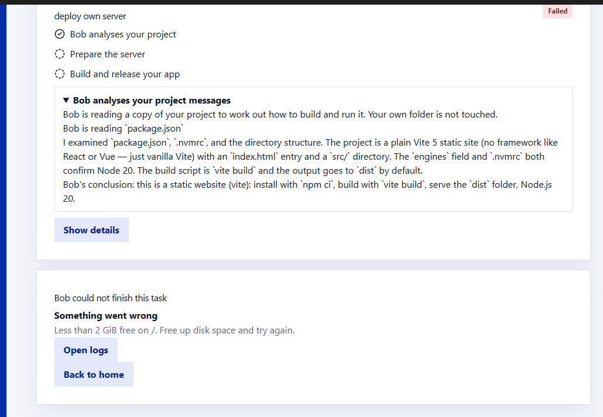
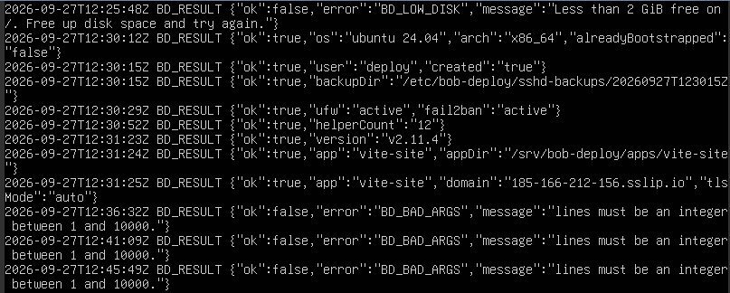
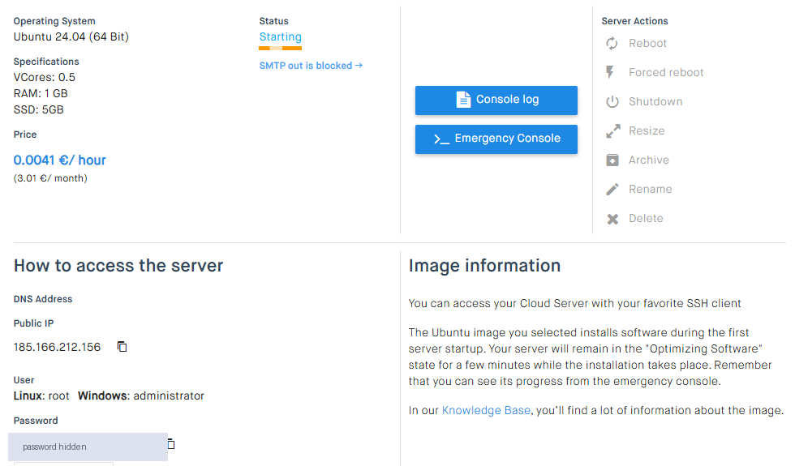
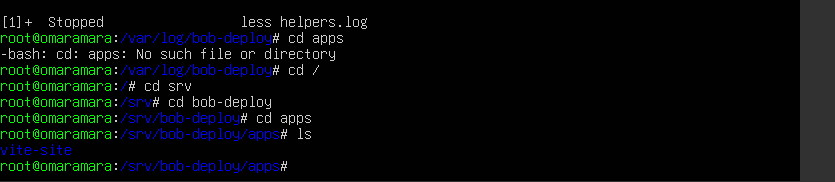
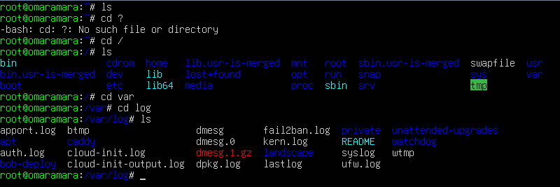

<p align="center">
  
</p>

<h1 align="center">Bob Deploy</h1>

<p align="center">
  Put your AI-built site online in a few clicks, on your own server or on free hosting.
</p>

---

You can build a website with Claude, Codex, Cursor or Lovable in an afternoon. Putting it online is still the hard part: renting a server, SSH, firewalls, HTTPS, and then shipping updates without breaking what already works.

Bob Deploy is a desktop app that does that part for you. You pick a project folder and choose where it should run. Bob, an AI agent powered by IBM Bob, reads the project and works out how to build it. The app then sets up and secures the server and publishes the site over HTTPS.

## What it does

- **Two ways to publish.** Free hosting on **Netlify** or **Vercel** for simple sites, or **your own VPS** (Ubuntu 22.04 / 24.04) for apps with a backend.
- **Understands your project.** Bob reads a copy of your project and decides the stack, the build command and the start command. Static HTML, Vite, CRA, Astro, Next (static export), Express, Flask and FastAPI are supported.
- **Secures the server first.** It turns off root and password login and creates a key-only admin account. The firewall allows only SSH, HTTP and HTTPS, and fail2ban bans IPs that keep failing to log in.
- **HTTPS by default.** Caddy serves every site with a Let's Encrypt certificate. With no domain yet, `<your-ip>.sslip.io` works.
- **Safe updates.** Each release starts beside the live one and must pass health checks before it goes live. A broken release never replaces a working one, and rollback needs no rebuild and no AI.
- **Monitoring.** Health checks, visits, memory/CPU/disk use and maintenance tasks for each project, and a live viewer of the site inside the app.

## Screenshots

**Bob analyses the project.** Bob reads a copy of the project (your folder is never touched) and explains what he found. Here the app's preflight check also stopped the deploy early, because the server had less than 2 GiB of free disk space.



**From a fresh server to a live HTTPS site in 73 seconds.** This is the server's own log of every step the app ran: preflight, admin account, SSH hardening, firewall and fail2ban, helper install, Caddy, the app folder and the HTTPS site.



**It runs on a tiny VPS.** The test server has 0.5 vCPU, 1 GB of RAM and 5 GB of disk, and costs about €3 a month.



**What it leaves on the server.** One folder per app under `/srv/bob-deploy/apps`, and its own logs under `/var/log/bob-deploy`.




---

## How to test it

There are five ways to test it, from quickest to most complete. Commands are for Windows PowerShell. On macOS or Linux, set variables with `VAR=value` before the command instead.

### Requirements

| For | You need |
| --- | --- |
| Everything | Node.js **22.15+** and **pnpm 10** (`corepack enable`) |
| Real deploys (options 3 to 5) | **Bob Shell** on your computer, a Bob API key and your Team ID |
| Local test server (option 3) | **Docker Desktop** with the WSL 2 engine on Windows |
| Real server (option 4) | A VPS running Ubuntu 22.04 or 24.04, its root password, and at least 2 GiB of free disk |
| Free hosting (option 5) | A Netlify or Vercel access token |

### Setup

```powershell
git clone https://github.com/Omar-Amaraa/bob-deploy.git
cd bob-deploy
pnpm install
pnpm build
```

### 1. Automated tests (no server needed)

```powershell
pnpm test          # all unit tests
pnpm typecheck
pnpm lint
```

### 2. Tour the app with fake data (no server, no Bob)

In development the app starts in **mock mode** by default. Every screen works with built-in fake projects and servers, and nothing leaves your computer.

```powershell
pnpm --filter @bob-deploy/app-shell dev
```

Create an account, add a project, run a deploy and open the dashboards to see the full interface.

### 3. Real deploy to a local test server (Docker)

The `testbed` folder runs a disposable "fresh VPS" in Docker: Ubuntu 24.04 with systemd, SSH with root password login, and ufw. The app deploys to it exactly as it would to a real server.

**Start the test server** and wait until `docker ps` shows it as `(healthy)`:

```powershell
node testbed/reset.mjs ubuntu2404
```

| Test server | SSH | HTTP | HTTPS |
| --- | --- | --- | --- |
| `ubuntu2404` | 2222 | 8080 | 8443 |
| `ubuntu2204` | 2223 | 8081 | 8444 |

The root password is the `rootPassword` value in `testbed/test-secrets.json`.

**Start the app in real mode, pointed at the test server:**

```powershell
$env:BOB_DEPLOY_MOCK="0"; $env:BOB_DEPLOY_TESTBED="1"; pnpm --filter @bob-deploy/app-shell dev
```

**Deploy one of the example projects:**

1. Create your account and connect Bob (API key and Team ID).
2. Add a project and pick a folder from `examples/own-server/`. `vite-site` or `static-html` are the quickest.
3. **Put project online → My own server**, and fill in:

   | Field | Value |
   | --- | --- |
   | Domain | `mysite.bd.test` (any name ending in `.bd.test`) |
   | Server IP | `127.0.0.1` |
   | SSH port | `2222` |
   | Login name | `root` |
   | Password | `rootPassword` from `testbed/test-secrets.json` |

4. Start the setup and follow each step live.
5. When it finishes, the **Viewer** tab shows the site. To open it in your own browser, add `127.0.0.1 mysite.bd.test` to your hosts file (`C:\Windows\System32\drivers\etc\hosts`, as administrator). Then open `https://mysite.bd.test:8443` and accept the self-signed certificate warning; the test server has no real certificate.

**Check what it did on the test server:**

```powershell
docker compose -f testbed/docker-compose.yml exec ubuntu2404 ufw status verbose
docker compose -f testbed/docker-compose.yml exec ubuntu2404 sshd -T
docker compose -f testbed/docker-compose.yml exec ubuntu2404 sudo -l -U deploy
```

To start over from a fresh server, run `node testbed/reset.mjs ubuntu2404` again.

**Automated tests against the test servers** (both need to be running):

```powershell
node testbed/reset.mjs all
pnpm test:integration     # full deploys, hardening and releases
pnpm test:failure         # failure injection: broken SSH config, failed releases, rollback
```

### 4. Real deploy to your own server

Start the app in real mode (without the testbed variable):

```powershell
$env:BOB_DEPLOY_MOCK="0"; Remove-Item Env:BOB_DEPLOY_TESTBED -ErrorAction SilentlyContinue; pnpm --filter @bob-deploy/app-shell dev
```

In **My own server**, enter your server's IP, `root` and its root password. For the domain, use your own domain with an A record pointing to the server. Without a domain, use `<ip-with-dashes>.sslip.io`, for example `203-0-113-9.sslip.io` for 203.0.113.9. **Check DNS** confirms it points to the server.

Before you start, open your provider's web console and check you can log in there as root. After the setup, SSH accepts only the app's admin key, so that console is your emergency way in.

Once the site is live, check the server from that console:

```bash
ufw status verbose                     # only 22, 80, 443 open
sshd -T | grep -E '^(permitrootlogin|passwordauthentication|allowusers) '
fail2ban-client status sshd
sudo -l -U deploy                      # only the 12 bd-* helper scripts
ls -l /srv/bob-deploy/apps/
tail /var/log/bob-deploy/helpers.log   # every step the app ran
```

From your own computer, `ssh root@<ip>` is now refused with `Permission denied (publickey)`.

### 5. Free hosting (Netlify or Vercel)

1. In **Settings → Free hosting**, paste a Netlify or Vercel access token.
2. Add a static project (any folder in `examples/own-server/` without a backend works).
3. **Put project online → Free hosting**, pick the host and a unique site name, and publish.
4. The app checks that the home page and the built files are actually online before marking the site live.

### End-to-end UI tests (optional)

```powershell
pnpm --filter @bob-deploy/app-shell e2e
```

---

## How the own-server deploy works

| Step | What happens |
| --- | --- |
| Reach your server | Connects once as root with the provider's password. The password is kept in memory for this task only and never saved. |
| Confirm the server identity | Shows the server's key fingerprint before trusting it. |
| Create the admin account | Creates a key-only `deploy` user. Its ed25519 key is generated locally and stored only in the encrypted vault. |
| Secure the server | Turns off root login and password login and allows only `deploy`. A second login is tested before the root session closes, and the old config is restored if that login fails. |
| Prepare the server | Sets up ufw (22, 80, 443) and fail2ban, and installs 12 fixed helper scripts. `deploy` can run those scripts as root and nothing else. |
| Understand your project | Bob and the detection rules decide the stack, build and start commands. |
| Install the project tools | Installs the runtime (Node or Python) and Caddy. |
| Set up the secure address | Writes the Caddy site and gets a Let's Encrypt certificate. |
| Publish your site | Uploads a new release, health-checks it, then switches it live in one atomic step. |

## Security

- **Local vault.** Every secret (server keys, host tokens, env vars) lives in an AES-256-GCM vault on your computer. Its key comes from your master password through Argon2id, and a one-time recovery code is the only way back in.
- **Bob works on a copy.** Every change he makes goes through a diff check before it reaches your folder, and he can only run allowlisted commands. Project content is treated as untrusted, so instructions hidden in your files are ignored.
- **Fixed server scripts.** Everything that runs as root is fixed code in this repo. The AI never writes or edits those scripts.
- **Hardened Electron app.** Context isolation, sandboxing and a strict content security policy.

## Project layout

| Folder | Role |
| --- | --- |
| `packages/contracts` | Shared types, schemas and validation |
| `packages/core` | Account and vault, database, job engine and deploy/update/rollback flows |
| `packages/agent` | Bob integration: staging copy, diff gate, prompts and stack detection |
| `packages/ssh-playbooks` | SSH client, server hardening scripts, helpers and the blue/green release |
| `packages/providers` | Netlify and Vercel APIs |
| `packages/monitors` | Health, resources, logs and maintenance parsing |
| `packages/ui` | React interface |
| `packages/app-shell` | Electron shell |
| `examples/own-server` | Ready-to-deploy example projects, one per supported stack |
| `testbed` | Docker test servers (Ubuntu 24.04 and 22.04) |
| `fixtures` | Recorded server and host API outputs used by the tests |
